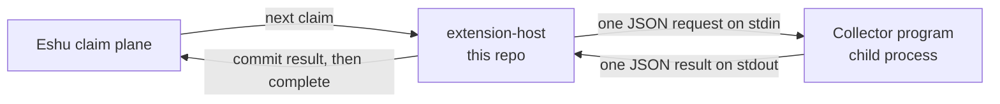

# eshu-extension-host

Status: pre-release. It doesn't replace the host that runs inside
Eshu core yet, and by default it does no collection work at all.

Here's what it is: some Eshu collectors ship as separate one-shot
programs that read one request, write one result, and exit. They
don't poll for work. This host does that part for them. It asks Eshu
for the next job, starts the collector program, keeps the job's
lease alive while it runs, and sends the result back.



In words: the host claims work, runs one collector per claim over
standard input and output, heartbeats while it runs, then commits
the result and completes the claim. But only when you turn claiming
on. A plain start serves health and metrics and touches nothing.

## When you'd use it, and when you wouldn't

Use it when a deployment needs to run a component collector as a
separate program under this standalone host, with claims turned on.

Skip it if you expect collection on a plain start (you won't get
any), if you need a collector itself (there's no collector logic
here, just the supervisor), or if you need stored state. The host
keeps none. Claims and results live in Eshu.

## Getting it running

The default posture, health only:

```bash
go run ./cmd/extension-host --admin-listen=:8082
curl http://127.0.0.1:8082/healthz   # {"status":"ok","mode":"dark",...}
```

"Dark" is this codebase's word for off. To actually claim work you
need `--claims-enabled` (or `ESHU_EXTENSIONHOST_CUTOVER_ENABLED=1`)
plus the environment in the configuration doc, including the path of
the collector binary to run. `--dry-run` rehearses the enabled flow
without committing results.

## Documentation

| Doc | What's in it |
|---|---|
| [docs/README.md](docs/README.md) | Documentation index: start here |
| [docs/getting-started/README.md](docs/getting-started/README.md) | Run health-only, then learn what claiming takes |
| [docs/guides/](docs/guides/README.md) | Operate, troubleshoot, collector placement, and release |
| [docs/concepts/](docs/concepts/README.md) | The claim contract and boundaries |
| [docs/reference/configuration.md](docs/reference/configuration.md) | Flags, the enabled-mode environment, and the cutover gate |
| [docs/architecture/README.md](docs/architecture/README.md) | Where the host sits in Eshu |
| [docs/diagrams/README.md](docs/diagrams/README.md) | Every diagram, with captions and text versions |
| [docs/decisions/README.md](docs/decisions/README.md) | Architecture decision records |
| [docs/contributing/README.md](docs/contributing/README.md) | Local gates before a pull request |
| [PROVENANCE.md](PROVENANCE.md) | Source pin, release, and rollback notes |
| [CONTRIBUTING.md](CONTRIBUTING.md) | Local gates and CI lanes |

Vocabulary the docs lean on: a claim is one unit of collector work
handed out by Eshu, a lease is its time limit, a heartbeat extends
that limit, and the claim plane is the Eshu HTTP service handing
claims out. This host is a client of it.

## Related repos

- [eshu](https://github.com/eshu-hq/eshu): core. It runs the claim
  plane this host polls.
- [eshu-sdk](https://github.com/eshu-hq/eshu-sdk): the collector
  contract. Requests sent to child collectors carry protocol version
  `collector-sdk/v1alpha1`.
- The component collectors (for example
  [eshu-collector-aws-cloud](https://github.com/eshu-hq/eshu-collector-aws-cloud)):
  the programs this host can run, one per claim.

## Development

Go `1.26.10` (pinned in `go.mod`, no external dependencies). Run
`make ci` for lint, tests, and the race suite with its coverage
floor.

## Contributing, security, license

See [CONTRIBUTING.md](CONTRIBUTING.md) before opening a pull
request. There's no SECURITY.md in this repo. The license is MIT;
see [LICENSE](LICENSE).
