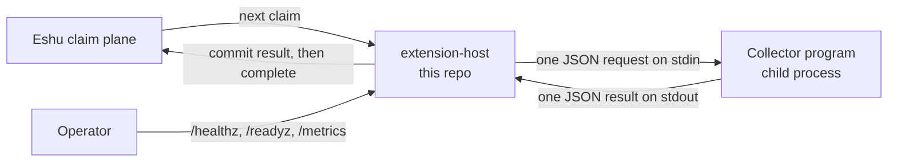
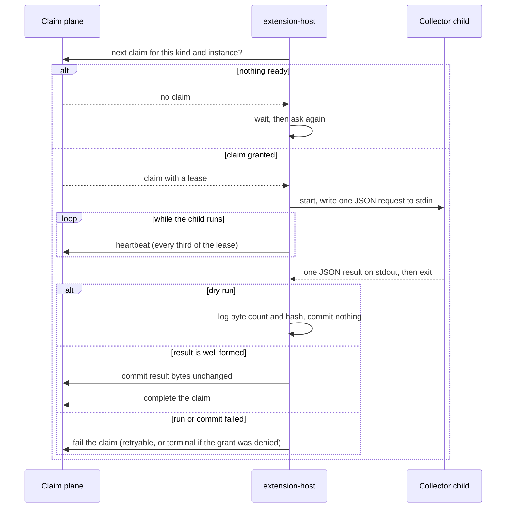

# Diagrams

Every diagram for `eshu-extension-host` lives here, each
with a caption and a text version. Other pages link here
instead of copying diagrams. The
[top-level README](../../README.md) keeps the first overview
only.

## The pieces

Caption: the host claims work from the claim plane, runs one
collector child per claim over stdin/stdout, and commits the
result back. Operators read health and metrics separately.

Text version: the host asks the claim plane for work. For
each claim it starts the collector program, sends one JSON
request on stdin, heartbeats while it runs, reads one JSON
result from stdout, commits that result to the claim plane,
then marks the claim complete. Separately, an operator can
read health and metrics from the admin listener.

## One claim, start to finish

Caption: enabled mode only. The host polls, runs the child,
heartbeats at one third of the lease, and commits, completes,
fails, or (in dry run) only logs the result.

Text version: ask for the next claim; wait and retry if none
is ready. On a granted claim, start the collector, write one
JSON request to stdin, heartbeat every third of the lease
while it runs, and read one JSON result from stdout. Dry run
logs byte count and hash and commits nothing. A well-formed
result is committed unchanged and the claim completed. A
failed run or commit fails the claim as retryable, or
terminal if the producer grant was denied.
